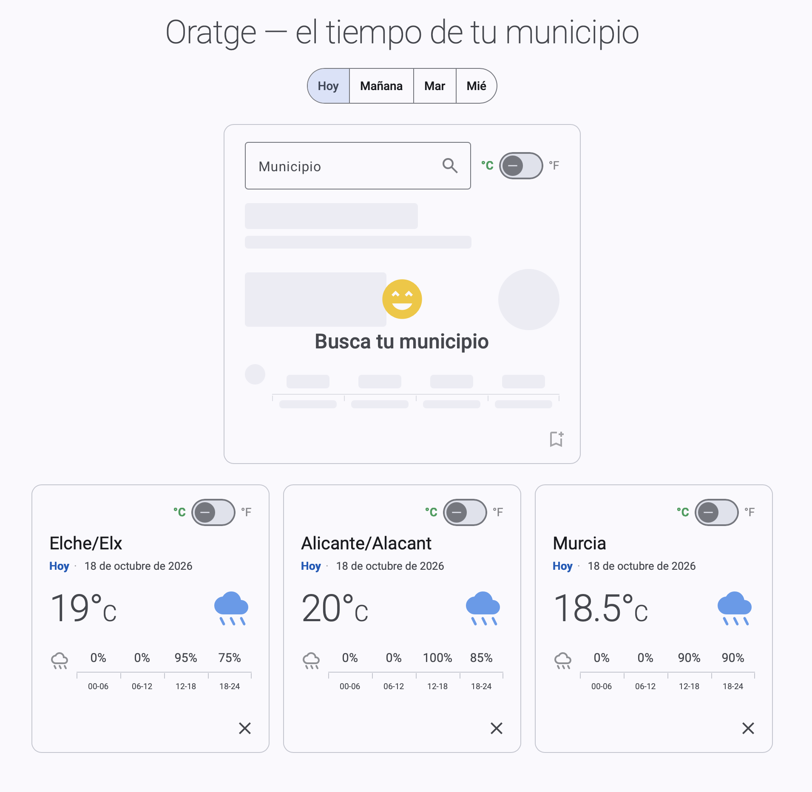

# Oratge

Aplicación de consulta meteorológica para los municipios de España. Permite buscar un
municipio, ver su predicción del día elegido en grados Celsius o Fahrenheit, y guardar
los municipios que consultas a menudo para tenerlos siempre a la vista.



El repositorio contiene dos proyectos independientes:

| Proyecto | Qué es |
|---|---|
| [`oratgeBack`](oratgeBack) | API REST en **Spring Boot 4 / Java 21**, con arquitectura hexagonal en módulos Maven. |
| [`oratgeFront`](oratgeFront) | SPA en **Angular 21 + Angular Material**, también con arquitectura hexagonal. |

## Origen de los datos

Los datos proceden de **[AEMET OpenData](https://opendata.aemet.es/dist/index.html)**, el
servicio abierto de la Agencia Estatal de Meteorología. El backend es el único que habla
con AEMET; el frontend solo consume nuestra propia API.

AEMET sirve los datos en dos pasos: una primera llamada autenticada devuelve una URL
temporal, y es esa URL la que contiene los datos reales. El backend encapsula ese detalle
para que el resto de la aplicación no tenga que conocerlo.

> Fuente de los datos meteorológicos: AEMET — Agencia Estatal de Meteorología.

## Endpoints

Ambos requieren la cabecera `X-Api-Key`.

### Buscar municipios por nombre

```
GET /municipio/search?name=malaga
```

Busca por coincidencia parcial, sin distinguir mayúsculas ni acentos (`malaga` encuentra
`Málaga`). Devuelve el código INE, que es lo que necesita el segundo endpoint.

```json
[
  { "codigo": "29067", "nombre": "Málaga" },
  { "codigo": "19166", "nombre": "Málaga del Fresno" },
  { "codigo": "29094", "nombre": "Vélez-Málaga" }
]
```

### Predicción de un municipio

```
GET /municipio/{codigo}?unidad=G_FAH&dia=1
```

| Parámetro | Obligatorio | Valores | Por defecto |
|---|---|---|---|
| `codigo` | Sí | Código INE del municipio | — |
| `unidad` | No | `G_CEL` (Celsius) o `G_FAH` (Fahrenheit) | `G_CEL` |
| `dia` | No | `0` = hoy, `1` = mañana… hasta `3` | `0` |

El límite de 3 días lo impone AEMET, que más allá no publica probabilidad de precipitación.

```json
{
  "fecha": "2026-10-19",
  "mediaTemperatura": 66.7,
  "unidadTemperatura": "G_FAH",
  "probPrecipitacion": [
    { "probabilidad": 5,  "periodo": "00-06" },
    { "probabilidad": 10, "periodo": "06-12" },
    { "probabilidad": 10, "periodo": "12-18" },
    { "probabilidad": 5,  "periodo": "18-24" }
  ]
}
```

Para hoy y mañana los tramos son de 6 horas; a partir del segundo día AEMET solo publica
medios días (`00-12` / `12-24`) y la respuesta lo refleja.

**Errores**: `400` parámetros fuera de rango · `401` falta la `X-Api-Key` ·
`404` municipio inexistente · `429` AEMET ha limitado las peticiones · `502` AEMET no responde.

## Arrancar el proyecto

Necesitas **Java 21** y **Node 22+**. Maven no hace falta: el proyecto incluye su wrapper.

### 1. Configurar las variables de entorno

Crea el fichero `oratgeBack/.env` (está excluido del repositorio):

```bash
# Clave de AEMET OpenData. Se solicita gratis en:
# https://opendata.aemet.es/centrodedescargas/altaUsuario
AEMET_API_KEY=tu_clave_de_aemet

# Clave propia que el frontend debe enviar en la cabecera X-Api-Key.
# Genera una cualquiera, por ejemplo con:
#   python3 -c "import secrets; print(secrets.token_urlsafe(32))"
ORATGE_API_KEY=tu_clave_de_la_api
```

| Variable | Usada por | Para qué |
|---|---|---|
| `AEMET_API_KEY` | Backend | Autenticarse contra AEMET OpenData. |
| `ORATGE_API_KEY` | Backend y frontend | Restringir quién puede llamar a nuestra API. |

El backend importa el `.env` directamente desde `application.yml`, así que no hay que
exportar nada a mano. Si falta alguna de las dos variables, la aplicación **no arranca**
y lo indica: es preferible a arrancar con una clave vacía y descubrirlo más tarde con
respuestas extrañas de AEMET.

En el frontend, el valor de `apiKey` en `oratgeFront/src/environments/environment.ts` debe
coincidir con `ORATGE_API_KEY`.

> Una clave incluida en un frontend es visible para cualquiera que inspeccione el
> navegador. Sirve para que la API no quede abierta a quien descubra la URL, no como
> autenticación de usuarios.

### 2. Arrancar el backend

```bash
cd oratgeBack
./mvnw clean install
./mvnw -pl oratge-bootstrap spring-boot:run
```

Queda en `http://localhost:8080`, con Swagger UI en `http://localhost:8080/swagger-ui.html`.

No hace falta ningún perfil: las claves se leen del `.env`. Existe un perfil `local`
opcional que solo acorta la caché a 10 minutos, útil mientras se desarrolla:

```bash
./mvnw -pl oratge-bootstrap spring-boot:run -Dspring-boot.run.profiles=local
```

### 3. Arrancar el frontend

```bash
cd oratgeFront
npm install
npm start
```

Queda en `http://localhost:4200`. En desarrollo usa el proxy de Angular CLI hacia el
puerto 8080, así que no depende de CORS.

## Pruebas

```bash
cd oratgeBack  && ./mvnw test   # tests del backend
cd oratgeFront && npm test      # tests del frontend
```

Se ejecutan también en cada *push* y *pull request* mediante GitHub Actions
(ver [`.github/workflows`](.github/workflows)).

Hay además una colección de Postman en
[`oratgeBack/oratgeBack.postman_collection.json`](oratgeBack/oratgeBack.postman_collection.json),
ejecutable con `npx newman run oratgeBack.postman_collection.json`.
